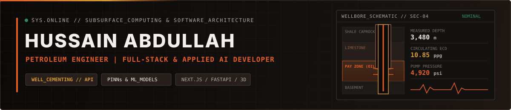

<!-- Custom Petro-Industrial Header Banner -->

 

<!-- Status & Identity Badges -->

---

### About Me

Petroleum Engineer and full-stack software developer focused on building computational tools, predictive maintenance platforms, and 3D subsurface visualizations for the energy sector.

- **Core Intersection:** Combining classical petroleum engineering equations (API cementing standards, hydraulics, directional drilling, material balance) with modern web stacks and machine learning.
- **Current Research:** Developing an AI-integrated web platform for oil well cementing design and hydraulic simulation, alongside reservoir diagenetic studies on the Yamama Formation in Nasiriyah Oilfield.

---

### Featured Engineering & Software Projects

| Project | Domain & Architecture | Core Capabilities |
| :--- | :--- | :--- |
| **[PetroCement Hub](https://github.com/Uvvvo)** | `Next.js` `FastAPI` `Three.js` `PINNs` | Full-stack oil well cementing design and hydraulic simulation platform featuring 21+ API-compliant calculators, interactive 3D wellbore cross-sections, and Physics-Informed Neural Networks. |
| **[ESP Sentinel Pro](https://github.com/Uvvvo)** | `Python` `Scikit-Learn` `React` `RBAC` | Predictive maintenance system for oilfield Electric Submersible Pumps achieving 98.78% diagnostic accuracy across 19 real-time sensor parameters with bilingual engineering reporting. |
| **[Tawfeer](https://github.com/Uvvvo/tawfeer-open)** | `React Native` `Expo` `TypeScript` | Open-source cross-platform personal finance and budget management application built with a clean, low-friction mobile architecture. |

---

### Technical Stack

#### Languages & Core Computing

  

#### Backend, AI & Scientific Libraries

  

#### Frontend, 3D Visualization & Mobile

  

#### Databases, Infrastructure & Tooling

  

---

### Engineering Domains

- **Petroleum & Subsurface:** Well Cementing Hydraulics, Slurry Design, Directional Drilling, Drilling Optimization, ESP Diagnostics, Reservoir Material Balance.
- **Applied AI & Data:** Physics-Informed Neural Networks (PINNs), Predictive Maintenance, Computer Vision, NumPy, pandas, Apache Parquet pipelines.
- **Systems & Security:** RESTful API Design, Role-Based Access Control (RBAC), OWASP Security Auditing, Automated Test Suites, Linux & Docker Environments.

---

### GitHub Telemetry

 

